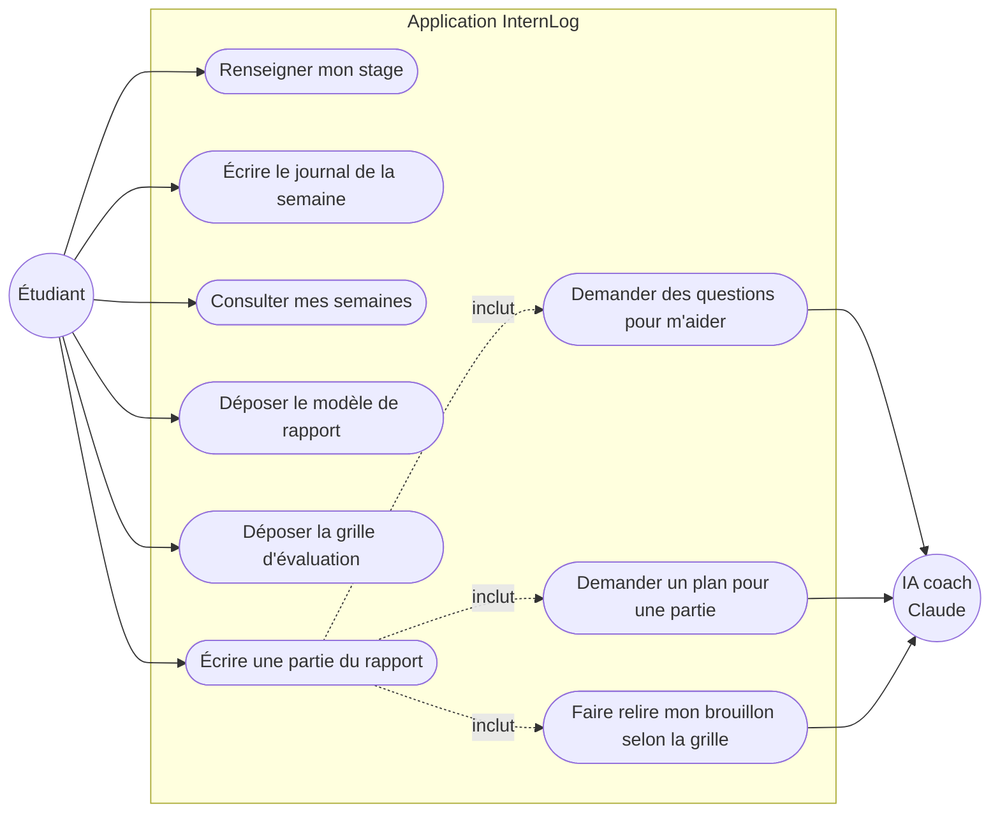
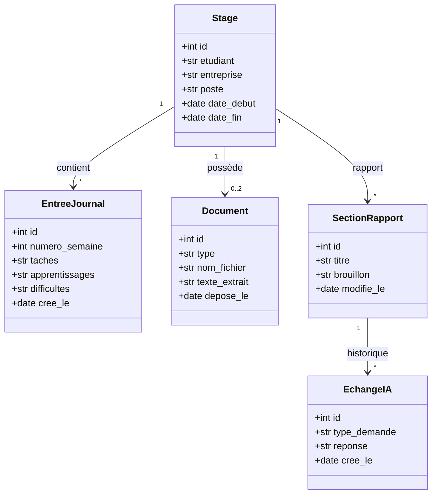
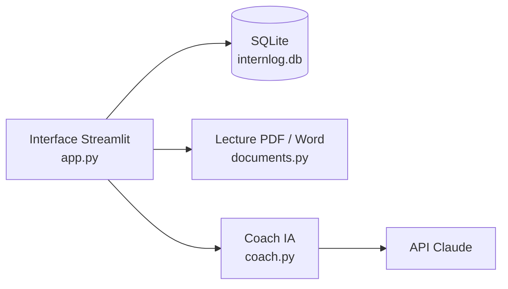

# InternLog : conception de la première version

InternLog suit le stage d'un étudiant semaine après semaine, puis l'aide à écrire son rapport **sans l'écrire à sa place**.

Cette version 1 concerne un seul utilisateur (l'étudiant) et tourne sur son ordinateur.

---

## 1. Diagramme de cas d'utilisation

Ce diagramme répond à la question : **qui fait quoi avec l'application ?**

En résumé :
- L'**étudiant** est l'acteur principal. Il fait tout dans l'application.
- L'**IA** est un acteur secondaire. Elle intervient seulement quand l'étudiant écrit son rapport, et elle répond à trois types de demande : des questions, un plan, une relecture.

---

## 2. Diagramme de classes (le modèle de données)

Ce diagramme répond à la question : **quelles informations l'application garde-t-elle, et comment sont-elles liées ?**

Ce qu'il faut retenir :
- Tout est rattaché à un **Stage**.
- Une **EntreeJournal** correspond à une semaine (3 champs courts, environ 2 minutes à remplir).
- Un **Document** (champ `type` : `modele` ou `grille`) est soit le modèle de rapport de l'école, soit la grille d'évaluation. On garde le texte extrait du fichier pour l'envoyer à l'IA.
- Une **SectionRapport** est une partie du rapport (par exemple « Présentation de l'entreprise »). C'est l'étudiant qui écrit le brouillon.
- Un **EchangeIA** (champ `type_demande` : `questions`, `plan` ou `relecture`) garde chaque réponse de l'IA pour pouvoir la relire plus tard.

---

## 3. Les règles de l'IA

L'IA joue le rôle d'un **tuteur**, pas celui d'un rédacteur. Ces règles se trouvent dans le prompt système (`internlog/coach.py`).

| L'IA peut | L'IA ne doit pas |
|---|---|
| Poser des questions qui s'appuient sur le journal | Rédiger des paragraphes prêts à copier |
| Proposer un plan sous forme de titres et de points clés | Inventer des faits absents du journal |
| Comparer le brouillon à la grille et dire ce qui manque | Donner une note |
| Citer les semaines du journal à utiliser | Réécrire le brouillon de l'étudiant |

Si l'étudiant demande « écris-le pour moi », l'IA refuse poliment et propose de l'aider avec des questions.

---

## 4. Architecture technique (simple)

- **Python + Streamlit** pour l'interface : une page web sans HTML à écrire.
- **SQLite** pour les données : un seul fichier, aucune installation.
- **pypdf / python-docx** pour lire le modèle et la grille.
- **API Claude** pour le coach.

---

## 5. Hors de la version 1 (pour plus tard)

- Préparation de la soutenance (questions du jury, entraînement à l'oral)
- Comptes multiples, accès du tuteur ou de l'école
- Rappels automatiques chaque semaine
- Export du rapport en Word
